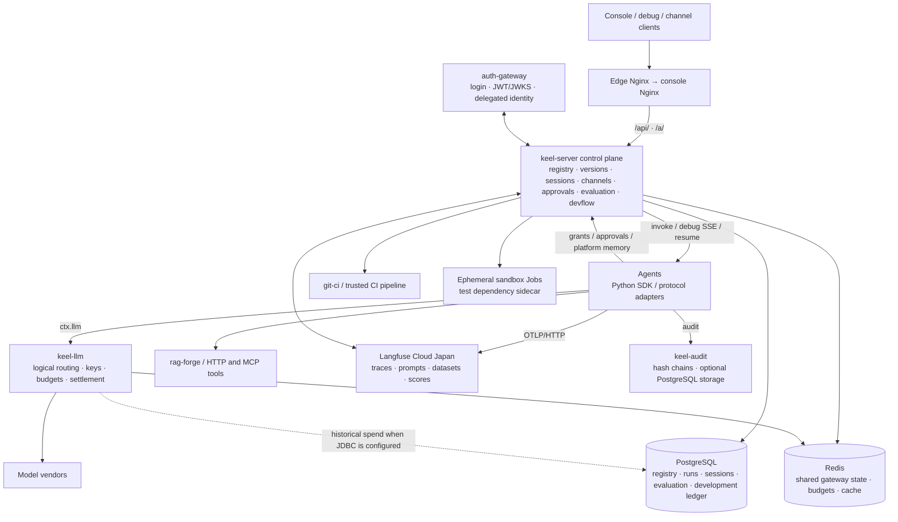
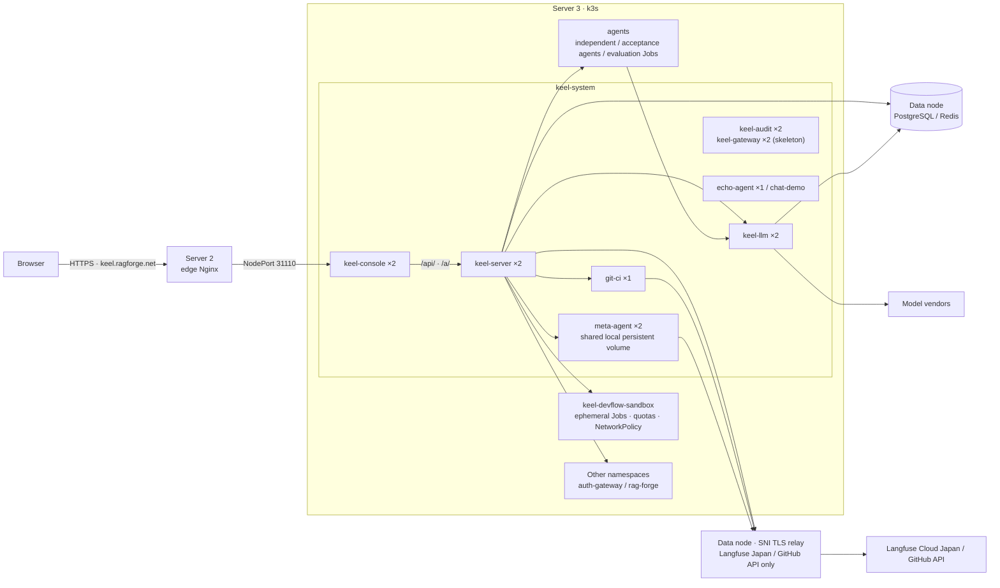

[简体中文](README.md) | **English**

# Keel: Agent Platform Foundation

Keel brings agent execution and governance into one platform: shared protocols, model access, knowledge and tool authorization, prompts, memory, tracing, audit, approvals, evaluation, and releases. Business agents declare capabilities in `agent.yaml` and access platform services through the SDK. The console manages their lifecycle from candidate versions to release, channel distribution, and retirement.

Python supports two development styles: workflows written with `@agent.entry`, and model/tool loops through `ctx.loop(...)`, bounded by step limits, tool permissions, guards, and context budgets. Existing frameworks can integrate through the standard protocol. The meta-agent and development workflow build on these capabilities to deliver independent projects through sandbox checks, evaluation, and human gates.

> This README describes the current code and deployment configuration. Designed capabilities are not necessarily deployed; see [Implementation and boundaries](#implementation-and-boundaries). The platform currently accepts writes for `staging` and `prod`; legacy `dev/test` remain for protocol compatibility, historical reads, and local development.

## Contents

- [Platform capabilities](#platform-capabilities)
- [Runtime architecture](#runtime-architecture)
- [Repository layout](#repository-layout)
- [Implementation and boundaries](#implementation-and-boundaries)
- [Local development](#local-development)
- [Evaluation and releases](#evaluation-and-releases)
- [Deployment architecture](#deployment-architecture)
- [Contracts and conventions](#contracts-and-conventions)
- [Documentation](#documentation)

## Platform capabilities

| Capability | Current use and responsibility |
|---|---|
| Protocol and run lifecycle | `keel/v1` defines manifests, invocation, SSE, health, and feedback; the Python SDK provides execution, cancellation, suspension, checkpoints, and resumption |
| Models and cost | `ctx.llm` accesses `keel-llm`: virtual keys, CNY daily budgets, channel allocations, rate limits, concurrency, streaming settlement, and spend records |
| Logical model routing | Logical names such as `chat-default` decouple agents from specific models; route-table drafts, grant checks, publishing, rollback, canary routing, and replay of the last 24 hours of requests |
| Knowledge and tools | `ctx.knowledge` accesses rag-forge; local tools, shared HTTP/MCP tools, delegation, and platform grants; skills load by declared and authorized version and do not grant tool access |
| Guards and approval | Input/output checks, taint and trust handling; high-risk tools suspend according to approval policy and resume afterward |
| Layered memory | Original session messages, recent complete turns, rolling summaries, in-session history search, reference lookup, and a fact-conflict ledger; long-term user memory is separately authorized and managed |
| Prompts and versions | Local Git copies link to managed Langfuse versions; environment labels are `staging` / `production`, with production labels moved through controlled releases |
| Observability and audit | OTel semantic traces go to Langfuse; the console displays debug SSE, tool/guard/memory nodes, cost, and run state, with durable chat requestId deduplication, SSE heartbeats, and reconciliation of known billed usage; audit follows field allowlists and synchronous writes for high-risk actions |
| Evaluation and release | Datasets, scorers, candidate evaluations, baselines, and regression gates; releases bind gate results to the corresponding image and prompt snapshots |
| Development and channels | Development ledger, H1–H4 human gates, sandboxes, Git/CI tools, and holdout cases; hosted chat, web widgets, mini-programs, and channel distribution |

Memory preserves original messages and does not treat user statements as independently verified facts. Summary and fact maintenance calls carry a purpose marker through the governed model client; the gateway applies maintenance settings scoped to the authenticated key and actual model without changing business-call routing, grants, or budgets. Context is bounded by the default `KEEL_CONTEXT_TOKEN_BUDGET=10000` hard limit: recent complete turns are retained while older content is summarized and retrieved as reference material. A current input that exceeds the limit is still rejected. Platform session originals are retained for 7 days, and the history transport window holds up to 128 messages. Summaries, retrieval, and fact ledgers are isolated by agent, environment, user, and session; evaluation traffic does not write ordinary session memory. See [context recovery](docs/specs/p1/P1-context-window-recovery.md), [history retrieval](docs/specs/p1/P1-session-history-retrieval.md), and [fact conflicts](docs/specs/p1/P1-session-fact-conflicts.md).

## Runtime architecture



This shows the main console and channel request path: browsers pass through two Nginx layers to `keel-server`, which handles authorization, sessions, and agent invocation. Model requests go through `keel-llm`. The separate `keel-gateway` is the designed unified agent entry point; its filters remain placeholders, so it is excluded from the currently usable request path.

The development workflow assigns requirement confirmation, evaluation confirmation, permission grants, and merge/release approval to H1–H4 gates. Humans maintain the meta-agent; generated code is checked in isolated sandboxes. Git/CI services handle repository and workflow operations, and the trusted release pipeline checks candidate commits, image digests, and approval bindings. See the [merged design](docs/design/Keel-智能体底座设计-20261014.html) and [trusted pipeline spec](docs/specs/r1014/R3-6-trusted-devflow-pipeline.md).

## Repository layout

```text
keel/
├── contracts/                   # keel/v1: manifest, invoke, SSE, audit, console API, errors, shared cases
├── keel-common/                 # Java contract models and error codes
├── keel-server/                 # Control-plane modules: registry, provisioning, discovery, tasks,
│                                # tool, approval, prompt, release, evaluation, memory,
│                                # channel, skill, devflow, insight, auth, and others
├── keel-llm/                    # OpenAI-compatible gateway, routing, keys/channels/budgets, spend ledger
├── keel-audit/                  # Audit ingestion, hash chains, and storage implementations
├── keel-gateway/                # Unified entry gateway skeleton (WebFlux)
├── keel-spring-boot-starter/     # Java protocol endpoints and tracing; some clients remain unimplemented
├── sdk-python/                  # Python runtime, ctx.loop, memory/guards, CLI, keel-lite, evaluation gates
├── console/                     # Vue console, API types, development mocks, and tests
├── templates/                   # loop-agent, chat-rag, tool-agent, graph-agent, supervisor, java-spring
├── agents/                      # echo, chat-demo, meta-agent, lifecycle and main-flow acceptance agents
├── examples/                    # Integration and meta-agent examples
├── services/
│   ├── git-ci/                  # Git/CI MCP and controlled merge operations
│   ├── sandbox-sidecar/         # Sandbox test dependencies
│   └── devflow-pipeline/        # Trusted development pipeline scripts
├── deploy/                      # Per-service k3s manifests, images, Nginx, relays, and rollout scripts
├── .github/workflows/           # Platform CI/CD, SDK releases, development pipeline, candidate checks
├── ci/                          # Change detection, architecture, backend, and frontend gates
├── scripts/                     # Contract validation, code generation, SDK wheel builds
└── docs/                        # Designs, technical reference, prototypes, specs, acceptance evidence
```

The stack uses Java 21, Spring Boot 3.5.15, MyBatis-Plus, and Flyway; Python 3.11+, Starlette, pydantic v2, httpx, and OpenTelemetry; Vue 3, TypeScript, Vite 5, Element Plus, and Pinia. Deployment uses k3s, Docker, GitHub Actions, and Alibaba Cloud ACR. Shared dependencies include PostgreSQL, Redis, auth-gateway, rag-forge, and Langfuse Cloud Japan. RocketMQ is a dependency in the asynchronous audit design; this does not imply that the current manifests wire the full messaging path.

## Implementation and boundaries

| Module | Implementation and remaining boundaries |
|---|---|
| `keel-server` / `console` | Provisioning, discovery, candidates and releases, debug and sessions, knowledge/tools/skills, prompts, evaluation, channels, approvals, memory, and development tasks are implemented; external services and deployment credentials require separate setup |
| `sdk-python` | Workflows and tool loops, SSE, suspend/resume, guards, layered memory, independent templates, and `new/dev/register/eval/gate/release` are implemented; `retire` is parsed but still reports unimplemented, so retirement uses the platform API/console |
| `keel-llm` | Shared keys, budgets, channels, and dynamic routing; recent spend uses Redis, while PostgreSQL history requires JDBC configuration. Local operation without Redis/JDBC is not a persistent multi-replica deployment |
| `keel-audit` | Hash chains, verification, and a PostgreSQL `ChainStore` are implemented; `keel.audit.jdbc-url` enables it, otherwise storage falls back to memory. The current service manifest does not inject this setting, and query/export should not be treated as a complete persistent audit path |
| `keel-gateway` | Builds and deploys as a service, but authentication, routing, quota, and other filters remain placeholder classes |
| Java starter | Protocol endpoints and tracing exist; `LlmClient`, `ToolInvoker`, `Delegator`, and other classes remain placeholders, so feature parity with Python cannot be assumed |
| Meta-agent / devflow | The repository contains the maintained meta-agent project, development ledger, sandboxes, and trusted pipeline; designed employee roles, batch scenarios, and historical acceptance results do not establish current live state |

## Local development

### Console and control plane

Install JDK 21, Maven 3.9+, Node.js 22, and local PostgreSQL. Run these commands from the repository root; the database credentials match the `local` profile.

```bash
psql -h localhost -d postgres \
  -c "CREATE ROLE keel LOGIN PASSWORD 'keel'" \
  -c "CREATE DATABASE keel OWNER keel"

# Local login values are supplied by the operator; this profile does not use auth-gateway
export KEEL_CONSOLE_LOCAL_PASSWORD='<local login password>'
export KEEL_CONSOLE_LOCAL_SMS_CODE='<local SMS code>'
mvn -pl :keel-server -am package -DskipTests
java -Xmx384m -jar keel-server/target/keel-server-0.1.0-SNAPSHOT.jar \
  --spring.profiles.active=local
```

In another terminal, start the frontend from the repository root:

```bash
cd console
npm ci
VITE_API_MOCK=off npm run dev
# http://localhost:5173; /api proxies to localhost:8080
```

The `local` profile runs Flyway and loads demo data. It does not start the model gateway, rag-forge, Langfuse, or Git/CI services; those features need additional configuration. Pages using development mocks are not evidence of a real integration.

### Python SDK and independent agents

For platform source development, install the SDK from the repository root:

```bash
python3 -m venv .venv
source .venv/bin/activate
python -m pip install -e './sdk-python[test,eval]'

# Local protocol demo that requires no model service
keel new my-agent --template hello-agent
cd my-agent
keel dev
```

`keel dev` starts the reloadable agent on port 8000 and keel-lite audit/approval on port 8001, storing local state under `.keel/`. Without Langfuse configuration it uses a local trace receiver. It may still use a local `dev` identifier; this does not reopen platform writes for `dev/test`.

For a model/tool loop, use `keel new my-loop --template loop-agent`. Configure the model gateway, virtual key, and other environment variables declared by the generated `agent.yaml`, then use `ctx.loop(...)`. `keel dev` does not supply a real model or knowledge service.

Generated projects include README, AGENTS.md, business entry points, tools, prompts, evaluation, tests, a Dockerfile, and independent CI. Released projects should download and pin the official SDK wheel from GitHub Releases using `.keel-sdk-version`; the Java starter comes from GitHub Packages. Do not copy platform source or install a namesake package from public PyPI. See the [independent project spec](docs/specs/r1017/keel-new-independent-project.md) and each generated project's README.

### Validating changes

Prioritize affected modules locally; integration tests require their dependencies. Testcontainers needs Docker, and skipped tests do not establish integration success.

| Scope | Run from the repository root |
|---|---|
| Java module and dependencies | `mvn -pl :keel-server -am test` (replace the module name) |
| Python SDK | `.venv/bin/python -m pytest sdk-python/tests/<matching-directory> -q` |
| Console | `cd console && npm run typecheck && npm test` |
| Contracts | `bash scripts/validate-contracts.sh` |

## Evaluation and releases

A normal agent release proceeds through: independent project and credentials → `staging` registration → candidate and prompt synchronization → evaluation and gates → `staging` release → controlled `prod` release. The production prompt label is `production`; new writes no longer use `dev/test`.

The CLI provides the commands below. This is not a setup-free deployment script: prepare the platform URL, runtime credentials, datasets and scorers, a reachable agent endpoint, and a built image, and satisfy the platform's caller identity requirements first.

```bash
keel register --env staging
keel eval import --file evals/seed.jsonl
keel eval run --env staging --file evals/seed.jsonl
keel gate --env staging --endpoint "$KEEL_AGENT_ENDPOINT"
keel release --env staging --image "$KEEL_RELEASE_IMAGE"
```

`KEEL_SERVER_URL` is the platform root URL without `/api/v1`. A successful `keel gate` saves `.keel/gate-run-id`; `release` reads it or accepts `--gate-run-id`. Development holdouts and production releases additionally require trusted CI identity, candidate commit/image bindings, and approvals. A local gate alone does not replace that release process.

Platform validation and deployment use [keel-ci.yml](.github/workflows/keel-ci.yml) and [keel-cd.yml](.github/workflows/keel-cd.yml). Official SDK artifacts are built by [release-sdk.yml](.github/workflows/release-sdk.yml) on `sdk-v1.*` tags; development delivery uses [devflow-pipeline.yml](.github/workflows/devflow-pipeline.yml).

## Deployment architecture

This topology and its replica counts come from repository manifests; consult the cluster and deployment records for actual running instances and versions. The platform runs on the application node's k3s cluster (Server 3), with edge Nginx on Server 2. PostgreSQL, Redis, and the Cloud TLS relay run on the data node.



| Deployment part | Current configuration and entry point |
|---|---|
| Console | `deploy/k3s/console.yaml`; 2 replicas, NodePort 31110; both proxy layers disable buffering for debug SSE |
| Four backends | `deploy/k3s/services/keel-{server,llm,audit,gateway}.yaml`; 2 replicas each, ClusterIP; no separate public control-plane or model gateway admin port |
| Git/CI and built-in agents | `deploy/k3s/services/`; `git-ci`, `meta-agent`, `echo-agent`, and others currently use `keel-system`. The meta-agent is an exception to the intended layout; do not move it to `agents` based on a design diagram |
| Independent agents and evaluation | `agents` namespace; the platform manifest includes evaluation Job RBAC, while agent releases belong to their projects/trusted pipelines |
| Development sandbox | `deploy/k3s/sandbox/namespace.yaml`; namespace ceiling of 4 CPU / 8Gi / 4 Pods, DNS-only egress by default; package-source networking requires separately configured restricted egress |
| External dependencies | Reuse PostgreSQL, Redis, auth-gateway, and rag-forge; use Langfuse Cloud Japan, not the obsolete LiteLLM/Langfuse Compose drafts |

Operational details:

- **Deployment source**: CD selects affected services by path and compares `main` pushes against the latest complete deployment snapshot to include previously undeployed changes. PRs run tests/gates; `main` builds ACR images and rolls out services. Regular image tags use the first 12 commit SHA characters.
- **Ordering**: affected agents wait for required control-plane deployment success before rollout and smoke checks. The development pipeline also verifies deployed image digests. Rollout scripts must replace placeholder images before applying manifests.
- **Secrets and shared state**: vendor keys live only in `keel-llm-vendors`; agents receive their own virtual keys and service identities. Gateway replicas share budgets, keys, routing, channels, and recent spend in Redis; historical spend requires additional JDBC configuration.
- **Meta-agent storage**: both replicas share `.keel` with locking. The current single-node local volume provides process redundancy, not node failover. See the [meta-agent project](agents/meta-agent/README.md).
- **Cloud networking**: `hostAliases` routes Langfuse Japan / GitHub API traffic through a private SNI relay while preserving end-to-end TLS. Agent Git transport and CI logs have separate controlled paths. See the [Langfuse relay](deploy/langfuse/README.md) and [Git/CI networking](deploy/git-ci/README.md).
- **Validation and rollback**: check rollout, readiness, and channel/SSE smoke results, then verify image versions and spend records. Roll back individual services with `kubectl -n keel-system rollout undo deployment/<service>`. Read historical setup counts, four-environment descriptions, and memory-only billing notes alongside current code and manifests.

## Contracts and conventions

See [AGENTS.md](AGENTS.md) for the full rules. The main requirements are:

- Change cross-language structures in `contracts/` first, then update Java/Python. New `keel/v1` fields must be optional; breaking changes require a new version.
- Call models through `ctx.llm` / the corresponding platform client; business code must not call vendors directly or store vendor keys.
- Audit high-risk actions synchronously and reject execution if the write fails. Capture only `audit.captureFields`; audit tables are append-only.
- Model input/output belongs in generation observations. Do not spread raw content into ordinary spans, logs, or audit. Keep service tracing separate from agent semantic tracing.
- Register error codes in `contracts/error-codes.yaml`; use `{code, message, trace_id, retryable}` and emit SSE errors as `event: error`.
- Read or write a task spec under `docs/specs/` first. Base external integrations on [.cursor/rules/external-apis.mdc](.cursor/rules/external-apis.mdc) and verified implementations.

## Documentation

The linked design and operational documents are primarily in Chinese.

| Document | Purpose |
|---|---|
| [Technical reference](docs/architecture/Keel-技术文档.html) | Technical constraints, database, APIs, and key flows; authoritative for technical design conflicts |
| [Merged design · 2026-10-14](docs/design/Keel-智能体底座设计-20261014.html) | Platform design, agent-driven development, runtime, and lifecycle additions |
| [Merged console prototype · 2026-10-14](docs/console/Keel-控制台前端-20261014.html) · [Optimization prototype · 2026-10-18](docs/console/Keel-优化效果-20261018.html) | Interactions, debugging, guards, model routing, and cost design |
| [Two environments](docs/specs/r1020/two-environments.md) · [Dynamic routing](docs/specs/r1021/dynamic-model-routing.md) | Subsequent environment and model governance changes |
| [Context recovery](docs/specs/p1/P1-context-window-recovery.md) · [History retrieval](docs/specs/p1/P1-session-history-retrieval.md) · [Fact ledger](docs/specs/p1/P1-session-fact-conflicts.md) · [Maintenance calls](contracts/llm-maintenance.md) | Current memory, consistency, and isolation boundaries |
| [Chat and billing recovery](docs/specs/r1023/context-billing-reliability.md) | Retry deduplication, disconnect settlement, and trace token/billing reconciliation; unknown usage remains unsettled |
| [Independent projects](docs/specs/r1017/keel-new-independent-project.md) · [Development workflow](docs/specs/devflow/README.md) | Agent project boundaries and development delivery |
| [Document index](docs/README.md) · [Task records](docs/TASKS.md) · [Acceptance evidence](docs/qa/) | Full documentation and historical progress; past status is not current deployment state |
| [Deployment guide](deploy/README.md) · [Per-service manifests](deploy/k3s/services/) · [CD workflow](.github/workflows/keel-cd.yml) | Setup, current configuration, and automated deployment sources |
