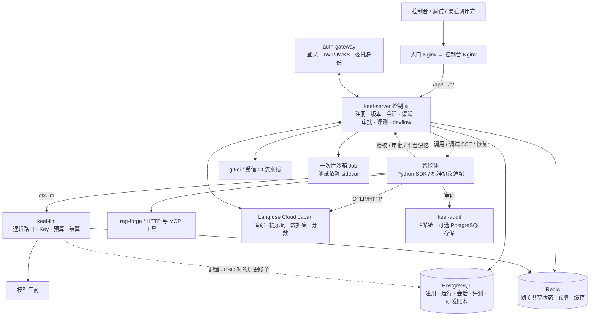
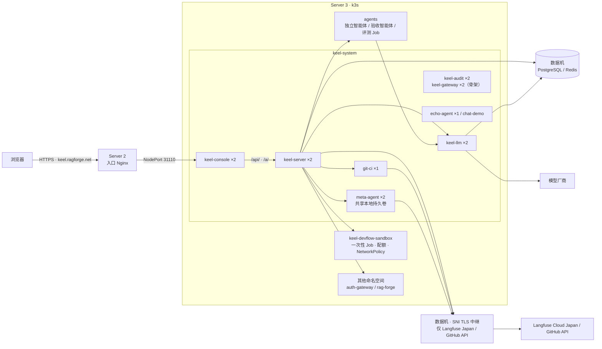

**简体中文** | [English](README.en.md)

# Keel 智能体平台底座

Keel 把智能体的运行与治理放在同一个平台：统一协议、模型网关、知识与工具授权、提示词、记忆、追踪、审计、审批、评测和发布。业务智能体通过 `agent.yaml` 声明能力，通过 SDK 使用平台服务；控制台管理从候选版本到上线、渠道分发和退役的生命周期。

平台同时提供两种 Python 开发方式：用 `@agent.entry` 编写工作流，或用 `ctx.loop(...)` 运行受步骤数、工具权限、护栏和上下文预算约束的模型工具循环。现有框架也可以通过标准协议接入。元智能体与研发流程在这些能力之上生成独立项目，经沙箱、评测和人工关口交付。

> 本文按当前代码与部署配置整理。设计中的能力不等于已经上线；实现边界见[当前实现与边界](#当前实现与边界)。平台当前可写环境为 `staging` 和 `prod`，旧 `dev/test` 仅保留协议、历史读取及本地开发兼容。

## 目录

- [平台能力](#平台能力)
- [运行架构](#运行架构)
- [仓库结构](#仓库结构)
- [当前实现与边界](#当前实现与边界)
- [本地开发](#本地开发)
- [评测与发布](#评测与发布)
- [部署架构](#部署架构)
- [契约与开发规范](#契约与开发规范)
- [文档入口](#文档入口)

## 平台能力

| 能力 | 当前使用方式与职责 |
|---|---|
| 统一协议与运行生命周期 | `keel/v1` 定义 manifest、invoke、SSE、健康检查和反馈；Python SDK 提供运行、取消、挂起、检查点与恢复 |
| 模型与成本 | `ctx.llm` 统一访问 `keel-llm`；虚拟 Key、人民币日预算、渠道份额、限流、并发、流式结算与成本明细 |
| 逻辑模型路由 | 如 `chat-default` 的逻辑入口与具体模型解耦；路由表草稿、授权检查、发布、回滚、灰度与近 24 小时历史回放 |
| 知识与工具 | `ctx.knowledge` 访问 rag-forge；本地工具、共享 HTTP/MCP 工具、委派及平台授权；技能按声明和授权版本加载，不代替工具授权 |
| 护栏与审批 | 输入/输出检测、污点与信任分层；按审批策略将高风险工具挂起，批准后恢复 |
| 分层记忆 | 会话原文、近期完整轮次、滚动摘要、会话内历史检索、引用回查、事实冲突账本；用户长期记忆单独授权和管理 |
| 提示词与版本 | Git 中的本地副本与 Langfuse 管理版本关联；环境标签为 `staging` / `production`，生产标签随受控发布移动 |
| 观测与审计 | OTel 语义追踪进 Langfuse；控制台展示调试 SSE、工具/护栏/记忆节点、费用和运行状态，支持聊天 requestId 持久化去重、SSE 心跳与已知账单用量回补；审计遵守字段白名单与高风险同步写入规则 |
| 评测与发布 | 数据集、评分器、候选版本评测、基线与回归门禁；发布绑定门禁及对应镜像/提示词快照 |
| 研发与渠道 | 研发任务账本、H1–H4 人工关口、沙箱、Git/CI 工具与隐藏考题；托管聊天页、网页挂件、小程序等渠道配置与分发 |

记忆不会替代原始消息，也不会把用户陈述当作已核实事实。摘要与事实维护通过受治理的模型客户端标记用途，网关按已认证 Key 和实际模型应用维护配置，不改变业务调用的路由、授权与预算。上下文默认受 `KEEL_CONTEXT_TOKEN_BUDGET=10000` 硬上限约束：保留近期完整轮次，较早内容经摘要和检索提供参考；当前输入本身超限仍会被拒绝。平台会话原文保留期为 7 天，历史传输窗口最多 128 条；摘要、检索与事实账本按智能体、环境、用户和会话隔离，评测流量不写入普通会话记忆。详见[上下文恢复](docs/specs/p1/P1-context-window-recovery.md)、[历史检索](docs/specs/p1/P1-session-history-retrieval.md)和[事实冲突](docs/specs/p1/P1-session-fact-conflicts.md)。

## 运行架构



这是当前控制台与渠道的主要调用路径：浏览器经两层 Nginx 到 `keel-server`，再由服务端完成授权、会话管理和智能体调用；模型调用统一走 `keel-llm`。独立的 `keel-gateway` 是设计中的统一智能体入口，其过滤器仍是占位实现，因此未画入当前可用请求链路。

研发流程将需求确认、评测确认、权限授予和合并发布分别设为 H1–H4 关口。元智能体由人维护，生成代码先在隔离沙箱验证；Git/CI 服务负责仓库与流水线操作，受信发布流程校验候选提交、镜像摘要和审批关系。详细流程见[合并设计](docs/design/Keel-智能体底座设计-20261014.html)和[受信流水线 spec](docs/specs/r1014/R3-6-trusted-devflow-pipeline.md)。

## 仓库结构

```text
keel/
├── contracts/                   # keel/v1：manifest、invoke、SSE、审计、控制台 API、错误码与共享用例
├── keel-common/                 # Java 契约模型与错误码
├── keel-server/                 # 控制面模块：registry、provisioning、discovery、tasks、
│                                # tool、approval、prompt、release、evaluation、memory、
│                                # channel、skill、devflow、insight、auth 等
├── keel-llm/                    # OpenAI 兼容薄网关、逻辑路由、Key/渠道/预算、费用账本
├── keel-audit/                  # 审计接收、哈希链与存储实现
├── keel-gateway/                # 统一入口网关骨架（WebFlux）
├── keel-spring-boot-starter/     # Java 协议端点与追踪，部分运行时客户端待实现
├── sdk-python/                  # Python 运行时、ctx.loop、记忆/护栏、CLI、keel-lite、评测门禁
├── console/                     # Vue 控制台、API 类型、开发 mock 与测试
├── templates/                   # loop-agent、chat-rag、tool-agent、graph-agent、supervisor、java-spring
├── agents/                      # echo、chat-demo、meta-agent、生命周期与主流程验收智能体
├── examples/                    # 接入与元智能体示例
├── services/
│   ├── git-ci/                  # Git/CI MCP 与受控合并操作
│   ├── sandbox-sidecar/         # 沙箱测试依赖
│   └── devflow-pipeline/        # 受信研发流水线脚本
├── deploy/                      # 按服务 k3s 清单、镜像构建、Nginx、中继与 rollout 脚本
├── .github/workflows/           # 平台 CI/CD、SDK 发布、研发流水线与候选验收
├── ci/                          # 变更范围、架构与前后端门禁
├── scripts/                     # 契约校验、代码生成、SDK wheel 构建
└── docs/                        # 设计、技术文档、原型、任务 spec 与验收证据
```

技术栈：Java 21、Spring Boot 3.5.15、MyBatis-Plus、Flyway；Python 3.11+、Starlette、pydantic v2、httpx、OpenTelemetry；Vue 3、TypeScript、Vite 5、Element Plus、Pinia。部署使用 k3s、Docker、GitHub Actions 和阿里云 ACR；共享依赖包括 PostgreSQL、Redis、auth-gateway、rag-forge 与 Langfuse Cloud Japan。RocketMQ 是异步审计设计依赖，不应据此推断当前清单已完整接通消息链路。

## 当前实现与边界

| 模块 | 已有实现与需注意的边界 |
|---|---|
| `keel-server` / `console` | 注册开通、探活对账、候选与正式版本、调试与会话、知识/工具/技能、提示词、评测、渠道、审批、记忆及研发任务已有实现；外部服务与部署凭据必须独立准备 |
| `sdk-python` | 工作流与工具循环、SSE、挂起恢复、护栏、分层记忆、独立模板及 `new/dev/register/eval/gate/release` 已实现；`retire` 仅有 CLI 入口，执行仍报未实现，退役使用平台 API/控制台 |
| `keel-llm` | 共享 Key、预算、渠道和动态路由；近期账单使用 Redis，配置 JDBC 后写 PostgreSQL 历史账单。未配置 Redis/JDBC 的本地模式不能视为跨副本持久化部署 |
| `keel-audit` | 哈希链、校验与 PostgreSQL `ChainStore` 已实现；需配置 `keel.audit.jdbc-url` 才启用，否则回退内存。当前服务清单未注入该配置，查询/导出也不能据此视为完整持久化审计链路 |
| `keel-gateway` | 服务可构建部署，但鉴权、路由、配额等过滤器仍为占位类 |
| Java starter | 协议端点和追踪已有实现；`LlmClient`、`ToolInvoker`、`Delegator` 等仍为占位类，不能假设与 Python SDK 功能对等 |
| 元智能体 / devflow | 仓库包含正式元智能体项目、研发账本、沙箱与受信流水线；不将设计中的全部研发员工、批次场景或历史验收结论当成当前在线状态 |

## 本地开发

### 控制台与控制面

准备 JDK 21、Maven 3.9+、Node.js 22 和本机 PostgreSQL。以下命令从仓库根目录执行；数据库账号与 `local` profile 一致。

```bash
psql -h localhost -d postgres \
  -c "CREATE ROLE keel LOGIN PASSWORD 'keel'" \
  -c "CREATE DATABASE keel OWNER keel"

# 本地登录口令由操作者设置；local profile 不连接 auth-gateway
export KEEL_CONSOLE_LOCAL_PASSWORD='<本地登录口令>'
export KEEL_CONSOLE_LOCAL_SMS_CODE='<本地短信验证码>'
mvn -pl :keel-server -am package -DskipTests
java -Xmx384m -jar keel-server/target/keel-server-0.1.0-SNAPSHOT.jar \
  --spring.profiles.active=local
```

在另一个终端从仓库根目录启动前端：

```bash
cd console
npm ci
VITE_API_MOCK=off npm run dev
# http://localhost:5173，/api 代理到 localhost:8080
```

`local` profile 会运行 Flyway 并加载演示数据，但不会启动模型网关、rag-forge、Langfuse 或 Git/CI 服务；相关功能需要另行配置。启用开发 mock 时，页面数据不能作为真实集成验收证据。

### Python SDK 与独立智能体

开发底座源码时，在仓库根目录安装 SDK：

```bash
python3 -m venv .venv
source .venv/bin/activate
python -m pip install -e './sdk-python[test,eval]'

# 无需模型服务的本地协议演示
keel new my-agent --template hello-agent
cd my-agent
keel dev
```

`keel dev` 启动热重载智能体（8000）和本地审计/审批服务 keel-lite（8001），在 `.keel/` 保存本地状态；未配置 Langfuse 时使用本地追踪接收器。它仍可能使用本地 `dev` 标识，这不代表平台重新开放 `dev/test` 写入。

需要模型工具循环时用 `keel new my-loop --template loop-agent`。按生成的 `agent.yaml` 配置模型网关、虚拟 Key 等环境变量后，通过 `ctx.loop(...)` 编排；`keel dev` 不会提供真实模型或知识服务。

新项目目录包含 README、AGENTS.md、业务入口、工具、提示词、评测、测试、Dockerfile 和独立 CI。发布项目应按 `.keel-sdk-version` 从 GitHub Release 下载并锁定正式 SDK wheel，Java starter 从 GitHub Packages 获取；不复制底座源码，也不按同名包从公共 PyPI 安装。详见[独立项目 spec](docs/specs/r1017/keel-new-independent-project.md)与生成项目自己的 README。

### 验证改动

本地优先验证受影响模块；集成测试需要对应依赖。Testcontainers 测试需要 Docker，跳过结果不算集成通过。

| 范围 | 从仓库根目录执行 |
|---|---|
| Java 模块及依赖 | `mvn -pl :keel-server -am test`（替换模块名） |
| Python SDK | `.venv/bin/python -m pytest sdk-python/tests/<相关目录> -q` |
| 控制台 | `cd console && npm run typecheck && npm test` |
| 契约 | `bash scripts/validate-contracts.sh` |

## 评测与发布

普通智能体的发布顺序为：准备独立项目和凭据 → 注册 `staging` → 同步候选与提示词 → 评测与门禁 → 发布 `staging` → 受控发布 `prod`。生产提示词标签为 `production`；新写入不再使用 `dev/test`。

CLI 已提供以下命令；这不是免配置的一键部署脚本。平台地址、运行凭据、数据集与评分器、可达智能体端点及已构建镜像必须先准备，并满足平台调用身份要求：

```bash
keel register --env staging
keel eval import --file evals/seed.jsonl
keel eval run --env staging --file evals/seed.jsonl
keel gate --env staging --endpoint "$KEEL_AGENT_ENDPOINT"
keel release --env staging --image "$KEEL_RELEASE_IMAGE"
```

`KEEL_SERVER_URL` 是平台根地址，不含 `/api/v1`。成功的 `keel gate` 会保存 `.keel/gate-run-id`，`release` 可读取它或接收 `--gate-run-id`。研发流程的隐藏考题和生产发布还受受信 CI 身份、候选提交/镜像摘要和审批约束；不能用一次本地门禁代替整条发布流程。

平台自身的测试与发布见 [keel-ci.yml](.github/workflows/keel-ci.yml)、[keel-cd.yml](.github/workflows/keel-cd.yml)；SDK 正式制品由 [release-sdk.yml](.github/workflows/release-sdk.yml) 的 `sdk-v1.*` 标签流程构建，研发交付使用 [devflow-pipeline.yml](.github/workflows/devflow-pipeline.yml)。

## 部署架构

下面按仓库清单展示部署拓扑和声明副本数，实际实例与版本以集群和部署记录为准。平台在应用节点（Server 3）的 k3s 上运行，入口 Nginx 位于 Server 2；PostgreSQL、Redis 及 Cloud TLS 中继在数据机。



| 部署部分 | 当前配置与入口 |
|---|---|
| 平台控制台 | `deploy/k3s/console.yaml`；2 副本，NodePort 31110；两层反代为调试 SSE 关闭缓冲 |
| 四个后端 | `deploy/k3s/services/keel-{server,llm,audit,gateway}.yaml`；各 2 副本，ClusterIP；控制面和薄网关管理口无独立公网端口 |
| Git/CI 与内置智能体 | `deploy/k3s/services/`；`git-ci`、`meta-agent`、`echo-agent` 等当前部署在 `keel-system`。元智能体是当前布局的例外，不能据设计图直接迁到 `agents` |
| 独立智能体与评测 | `agents` 命名空间；平台服务清单包含评测 Job 所需 RBAC；智能体发布由各自项目/受信流程负责 |
| 研发沙箱 | `deploy/k3s/sandbox/namespace.yaml`；命名空间上限 4 核 / 8Gi / 4 Pod，默认出站仅 DNS；需包源网络时必须另配受限放行策略 |
| 外部依赖 | 复用 PostgreSQL、Redis、auth-gateway 和 rag-forge；Langfuse 使用 Cloud Japan，不部署仓库内旧 LiteLLM/Langfuse Compose 草稿 |

运维要点：

- **部署来源**：CD 按路径选择受影响服务，并在 `main` 推送时从最近完整部署快照计算范围，避免遗漏此前未部署的变更。PR 只做测试/门禁；`main` 构建 ACR 镜像并滚动发布，常规镜像 tag 为提交 SHA 前 12 位。
- **部署顺序**：相关智能体发布等待必要控制面部署成功，之后冒烟；研发流水线还校验实际部署镜像摘要。文件占位镜像需由 rollout 脚本替换，不能直接将清单当可用镜像发布。
- **密钥与共享状态**：厂商 Key 仅位于 `keel-llm-vendors`；智能体使用各自注入的虚拟 Key 和服务身份。网关副本共享 Redis 中的预算、Key、路由、渠道和近期账单；长期账单需要额外 JDBC 配置。
- **元智能体存储**：两个副本共享 `.keel` 持久卷并使用锁；当前为单节点本地卷，提供进程冗余，不提供节点容灾。见[元智能体项目说明](agents/meta-agent/README.md)。
- **Cloud 网络**：`hostAliases` 经私网 SNI 中继访问 Langfuse Japan / GitHub API，保留端到端 TLS；智能体 Git 传输与 CI 日志另有受控路径。见[Langfuse 中继](deploy/langfuse/README.md)与[Git/CI 网络](deploy/git-ci/README.md)。
- **验证与回滚**：检查对应 Deployment 的 rollout、就绪探针和渠道/SSE 冒烟，再核对发布镜像与账单；按服务执行 `kubectl -n keel-system rollout undo deployment/<服务名>`。历史部署手册中的起步副本数、四环境或内存账单说明需结合当前代码与清单阅读。

## 契约与开发规范

完整约束见 [AGENTS.md](AGENTS.md)，主要规则为：

- 跨语言结构先改 `contracts/`，再更新 Java/Python；`keel/v1` 新字段必须可选，破坏性修改升版本。
- 模型调用只经 `ctx.llm` / 对应平台客户端，禁止业务代码直连厂商或保存厂商 Key。
- 高风险动作同步审计，写失败即拒绝执行；只采集 `audit.captureFields` 白名单，审计表只追加。
- generation 的输入输出承担模型原文观测，普通 span、日志与审计不任意扩散原文；服务级追踪与智能体语义追踪分开。
- 错误码登记于 `contracts/error-codes.yaml`，错误体统一 `{code, message, trace_id, retryable}`；SSE 错误发送 `event: error`。
- 先写或阅读 `docs/specs/` 中的任务 spec；外部接口以 [.cursor/rules/external-apis.mdc](.cursor/rules/external-apis.mdc) 和已核实实现为依据。

## 文档入口

| 文档 | 用途 |
|---|---|
| [技术文档](docs/architecture/Keel-技术文档.html) | 平台技术约束、数据库、接口与关键流程；设计冲突时的权威技术依据 |
| [合并设计 · 2026-10-14](docs/design/Keel-智能体底座设计-20261014.html) | 平台总体设计、全流程智能体化、运行时与生命周期补充 |
| [控制台合并原型 · 2026-10-14](docs/console/Keel-控制台前端-20261014.html) · [优化原型 · 2026-10-18](docs/console/Keel-优化效果-20261018.html) | 页面交互、调试、护栏、模型路由与成本设计 |
| [两环境收敛](docs/specs/r1020/two-environments.md) · [动态模型路由](docs/specs/r1021/dynamic-model-routing.md) | 后续环境与模型治理变更 |
| [上下文恢复](docs/specs/p1/P1-context-window-recovery.md) · [历史检索](docs/specs/p1/P1-session-history-retrieval.md) · [事实账本](docs/specs/p1/P1-session-fact-conflicts.md) · [维护调用](contracts/llm-maintenance.md) | 当前分层记忆、一致性与隔离边界 |
| [聊天与计量恢复](docs/specs/r1023/context-billing-reliability.md) | 聊天重试去重、断流结算、追踪 token 与账单对齐；未知用量不伪造结算 |
| [独立项目](docs/specs/r1017/keel-new-independent-project.md) · [研发流程](docs/specs/devflow/README.md) | 智能体项目边界与研发生产流程 |
| [文档索引](docs/README.md) · [任务记录](docs/TASKS.md) · [验收证据](docs/qa/) | 完整文档与历史进度；历史状态不等于当前部署状态 |
| [部署手册](deploy/README.md) · [按服务清单](deploy/k3s/services/) · [CD 工作流](.github/workflows/keel-cd.yml) | 部署准备、当前配置与自动发布来源 |
